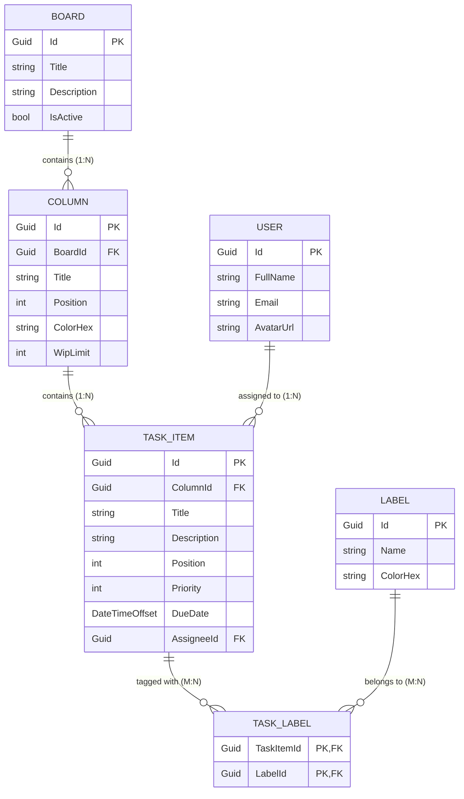

# TaskPulse — Full-Stack Implementation Process & Architecture Guide

> **Project**: TaskPulse — Full-Stack Minimal Kanban Board Application  
> **Document Reference**: TVS-DEV-AI-GL-01 AI Development Tools Guidelines v1.0  
> **Backend**: .NET 8 Web API (4-Layer Clean Architecture)  
> **Frontend**: Angular 22 (Standalone Components, Signals, OnPush)  
> **Database**: Microsoft SQL Server (EF Core Code-First, Soft Deletes)  
> **Status**: Approved Architecture & Implementation Roadmap  

---

## 1. Executive Summary & Objectives

TaskPulse is a lightweight, responsive Kanban board system designed for efficient task tracking across workflow columns (*To Do*, *In Progress*, *Done*). The implementation serves as a flagship reference project adhering to industrial Clean Architecture, strict separation of concerns, modern reactive frontend paradigms, and governed AI-assisted workflows.

### Core Capabilities
- **Board & Column Management**: Multi-column board layout with customizable column titles, order, and WIP (Work In Progress) indicators.
- **Card Lifecycle**: Task cards with title, description, priority indicators, tags/labels, due dates, and assignee metadata.
- **Interactive Drag-and-Drop**: Intra-column reordering and cross-column transitions with optimistic UI feedback and transactional database re-indexing.
- **Data Integrity**: Auditable entities with soft deletes, FluentValidation rules, and concurrency safety.

---

## 2. Technology Stack & Boundaries

| Component | Technology | Version / Pattern | Key Responsibilities |
| :--- | :--- | :--- | :--- |
| **Presentation Layer** | ASP.NET Core Web API | .NET 8 | Thin controllers, global error handling, OpenAPI/Swagger contracts |
| **Business Logic Layer** | Class Library | .NET 8 | Application services, DTO mappings, FluentValidation rules |
| **Data Access Layer** | EF Core | 8.x | `AppDbContext`, Fluent API mappings, migrations, repositories |
| **Domain Layer** | Class Library | .NET 8 | POCO entities, value objects, domain enums, base contracts |
| **Frontend Framework** | Angular | 22.x | Standalone components, Signals state management, OnPush strategy |
| **Drag & Drop** | Angular CDK | 22.x | Touch-friendly drag-and-drop column and card interactions |
| **Relational Database** | Microsoft SQL Server | 2022 / Azure SQL | Relational persistence, transactional indexing, soft-delete filtering |
| **Testing** | xUnit / Jest | Latest | xUnit + Moq + FluentAssertions (BE); Jest + Testing Library (FE) |

---

## 3. Database Schema Design (EF Core Code-First)

All entities inherit from `BaseEntity`:
- `Id` (`Guid`): Primary Key (UUIDv4)
- `CreatedAt` (`DateTimeOffset`): UTC creation timestamp
- `CreatedBy` (`string?`): Audit user identity
- `UpdatedAt` (`DateTimeOffset?`): UTC modification timestamp
- `UpdatedBy` (`string?`): Modifying user identity
- `IsDeleted` (`bool`): Soft-delete flag (default: `false`)
- `DeletedAt` (`DateTimeOffset?`): Soft-delete timestamp

### Entity-Relationship Diagram



### Table Definitions & Fluent API Constraints

1. **`Boards`**
   - `Title`: `nvarchar(100)`, Required
   - `Description`: `nvarchar(500)`, Nullable
   - `IsActive`: `bit`, Default `1`
   - Global Filter: `HasQueryFilter(e => !e.IsDeleted)`

2. **`Columns`**
   - `BoardId`: Foreign Key -> `Boards.Id` (Cascade delete restricted)
   - `Title`: `nvarchar(50)`, Required
   - `Position`: `int`, Required (Indexed with `BoardId` for fast ordering)
   - `ColorHex`: `nvarchar(7)`, Default `#64748B`
   - `WipLimit`: `int?`, Optional

3. **`TaskItems`**
   - `ColumnId`: Foreign Key -> `Columns.Id` (Cascade delete restricted)
   - `Title`: `nvarchar(200)`, Required
   - `Description`: `nvarchar(2000)`, Nullable
   - `Position`: `int`, Required
   - `Priority`: `int` (Enum: `1 = Low`, `2 = Medium`, `3 = High`, `4 = Urgent`)
   - `DueDate`: `datetimeoffset`, Nullable
   - `AssigneeId`: Foreign Key -> `Users.Id`, Nullable
   - Composite Index: `(ColumnId, Position)`

4. **`Labels` & `TaskLabels`**
   - `Labels`: `Name` (`nvarchar(50)`, Unique), `ColorHex` (`nvarchar(7)`)
   - `TaskLabels`: Composite PK `(TaskItemId, LabelId)`

---

## 4. REST API Specification

### Response Contract Standard (`ApiResponse<T>`)
```json
{
  "success": true,
  "message": "Resource retrieved successfully",
  "data": { ... },
  "errors": []
}
```

### Route Registry

| Category | Verb | Endpoint | Description | Request DTO | Response DTO |
| :--- | :--- | :--- | :--- | :--- | :--- |
| **Boards** | `GET` | `/api/v1/boards` | List boards with column summary | — | `ApiResponse<IEnumerable<BoardSummaryDto>>` |
| | `GET` | `/api/v1/boards/{id}` | Get full board (columns + tasks) | — | `ApiResponse<BoardDetailDto>` |
| | `POST` | `/api/v1/boards` | Create new board | `CreateBoardDto` | `ApiResponse<BoardDetailDto>` |
| **Columns** | `POST` | `/api/v1/boards/{boardId}/columns` | Add column to board | `CreateColumnDto` | `ApiResponse<ColumnDto>` |
| | `PUT` | `/api/v1/columns/{id}` | Update title, color, WIP limit | `UpdateColumnDto` | `ApiResponse<ColumnDto>` |
| | `DELETE` | `/api/v1/columns/{id}` | Soft delete column | — | `ApiResponse<void>` |
| | `PUT` | `/api/v1/boards/{boardId}/columns/reorder` | Update column positions | `ReorderColumnsDto` | `ApiResponse<IEnumerable<ColumnDto>>` |
| **Tasks** | `POST` | `/api/v1/columns/{columnId}/tasks` | Create task card | `CreateTaskDto` | `ApiResponse<TaskItemDto>` |
| | `GET` | `/api/v1/tasks/{id}` | Fetch task details | — | `ApiResponse<TaskItemDto>` |
| | `PUT` | `/api/v1/tasks/{id}` | Update title, description, priority | `UpdateTaskDto` | `ApiResponse<TaskItemDto>` |
| | `PATCH` | `/api/v1/tasks/{id}/move` | Move across columns / reorder | `MoveTaskDto` | `ApiResponse<TaskItemDto>` |
| | `DELETE` | `/api/v1/tasks/{id}` | Soft delete task | — | `ApiResponse<void>` |
| **Labels** | `GET` | `/api/v1/labels` | List all tags | — | `ApiResponse<IEnumerable<LabelDto>>` |
| | `POST` | `/api/v1/labels` | Create tag | `CreateLabelDto` | `ApiResponse<LabelDto>` |

---

## 5. Frontend Architecture (Angular 22)

### Directory Layout
```
src/app/
├── core/
│   ├── interceptors/             # ApiUrlInterceptor, ErrorInterceptor
│   ├── models/                   # ApiResponse<T>, BaseEntity
│   └── services/                 # NotificationService
│
├── shared/
│   ├── components/               # BadgeComponent, AvatarComponent, ConfirmModalComponent
│   └── pipes/                    # FormatDatePipe, TruncatePipe
│
└── features/
    └── task-board/
        ├── components/
        │   ├── board-header/     # Board title, filters, search input, "Add Task" button
        │   ├── board-column/     # Column container, task count, drag-drop drop list
        │   ├── task-card/        # Card display (priority tag, title, assignee, drag handle)
        │   └── task-dialog/      # Reactive modal for task create & edit
        ├── models/               # Board, Column, TaskItem, TaskPriority
        ├── services/             # BoardService (HTTP), TaskStateService (Signals Store)
        ├── pages/
        │   └── board-page/       # Main board shell orchestrating column drop lists
        └── task-board.routes.ts
```

### State Management via Signals
`TaskStateService` maintains an immutable local representation of the board state:
- `board = signal<BoardDetail | null>(null)`: Primary board data.
- `searchTerm = signal<string>('')`: Real-time text filter.
- `priorityFilter = signal<TaskPriority | null>(null)`: Priority pill filter.
- `filteredColumns = computed(() => ...)`: Derived slice filtering tasks across columns without triggering re-fetches.
- **Optimistic Drag-and-Drop**: Moves cards instantly in local signal state, invoking the backend `/move` endpoint. On failure, rolls back to snapshot with a notification banner.

---

## 6. Step-by-Step Implementation Roadmap

```
[Chunk 1: Solution & Domain] 
       ↓
[Chunk 2: Infrastructure & Migrations] (⚠️ Mandatory DB Approval Checkpoint)
       ↓
[Chunk 3: Application Logic & Validation]
       ↓
[Chunk 4: API Presentation & Middleware]
       ↓
[Chunk 5: Frontend Shared UI & Core Client]
       ↓
[Chunk 6: Kanban Feature & Signals State]
       ↓
[Chunk 7: Drag-and-Drop & CRUD Dialogs]
       ↓
[Chunk 8: Verification, Test Coverage & Change Log]
```

### Chunk 1: Solution Setup & Domain Foundations
- [ ] Initialize .NET 8 solution (`TaskPulse.sln`) with 4 Clean Architecture projects:
  - `TaskPulse.Domain`
  - `TaskPulse.Application`
  - `TaskPulse.Infrastructure`
  - `TaskPulse.API`
- [ ] Implement `BaseEntity` with audit fields (`Id`, `CreatedAt`, `IsDeleted`, etc.).
- [ ] Implement domain entities (`Board`, `Column`, `TaskItem`, `Label`, `User`) and `TaskPriority` enum.
- [ ] Define repository interfaces in `Domain.Interfaces` (`IBoardRepository`, `IColumnRepository`, `ITaskRepository`).

### Chunk 2: Infrastructure & Database Layer
- [ ] Set up `AppDbContext` in `TaskPulse.Infrastructure` using SQL Server.
- [ ] Write Fluent API configurations (`IEntityTypeConfiguration<T>`) for each entity with indexes, relationships, and soft-delete filters.
- [ ] Implement repository pattern and Unit of Work.
- [ ] Register infrastructure dependencies via `AddInfrastructure(IConfiguration)`.
- [ ] **SAFETY CHECKPOINT**: State exact schema changes, generate SQL script, and obtain explicit user approval before running `dotnet ef migrations add InitialKanbanSchema`.

### Chunk 3: Application Business Logic & Validation
- [ ] Define request and response DTO records (`CreateTaskDto`, `MoveTaskDto`, `BoardDetailDto`, etc.).
- [ ] Implement FluentValidation rules (`CreateTaskDtoValidator`, `MoveTaskDtoValidator`).
- [ ] Implement `BoardService` and `TaskService` handling transactional card position recalculations.
- [ ] Write unit tests with `xUnit`, `Moq`, and `FluentAssertions` in `TaskPulse.Application.Tests` (Coverage ≥ 80%).

### Chunk 4: API Presentation Layer
- [ ] Implement thin controllers: `BoardsController`, `ColumnsController`, `TasksController`.
- [ ] Implement `ExceptionHandlingMiddleware` mapping domain exceptions to RFC 7807 / `ApiResponse<T>` standards.
- [ ] Configure Swagger/OpenAPI, CORS policies, and dependency injection in `Program.cs`.
- [ ] Write integration tests in `TaskPulse.API.Tests` using `WebApplicationFactory`.

### Chunk 5: Angular Core & Shared Component Atoms
- [ ] Setup Angular 22 workspace with standalone configuration and SCSS design tokens.
- [ ] Configure `core/` with `ApiUrlInterceptor` and error handling service.
- [ ] Implement shared UI components: `BadgeComponent`, `AvatarComponent`, `LoadingSpinnerComponent`, `ConfirmModalComponent`.

### Chunk 6: Task Board Feature Layout & State Management
- [ ] Scaffold `features/task-board/` structure and route definitions.
- [ ] Implement `BoardService` (HttpClient wrapper) and `TaskStateService` (Signals store).
- [ ] Create `BoardPageComponent`, `BoardHeaderComponent`, and `BoardColumnComponent` using `ChangeDetectionStrategy.OnPush`.

### Chunk 7: Drag-and-Drop & Task CRUD Dialogs
- [ ] Integrate `@angular/cdk/drag-drop` across columns and task cards.
- [ ] Implement intra-column reordering and cross-column card movement with optimistic state updates and rollback handling.
- [ ] Implement `TaskDialogComponent` using strictly-typed reactive forms (`fb.nonNullable.group`).
- [ ] Implement task deletion with `ConfirmModalComponent`.

### Chunk 8: Verification, Quality Gates & Change Log
- [ ] Run full test suites (`dotnet test` and `npm test`).
- [ ] Verify build health and absence of linting errors.
- [ ] Update `ai-change-log.md` with documented achievements and test coverage metrics.

---

## 7. Edge Cases & Validation Rules

### Backend Validation Rules
1. **Contiguous Indexing**: Positions within a column must remain zero-based contiguous integers (`0, 1, 2, ...`). When moving task from index `X` to `Y`, rebalancing must execute within a database transaction.
2. **Column Deletion Protection**: Cannot delete a column containing active tasks unless tasks are explicitly migrated or cascade soft-deleted.
3. **WIP Limit Rules**: If `Column.WipLimit` is defined and active cards count reaches limit, moving cards into this column triggers a `400 Bad Request` with `WipLimitExceededException`.
4. **Field Constraints**:
   - `Board.Title`: 3 to 100 characters.
   - `TaskItem.Title`: 1 to 200 characters, whitespace-trimmed.
   - `DueDate`: Must not be in the past when creating new tasks.

### Frontend Edge Cases
1. **Empty Column Drop Target**: Columns with 0 tasks must provide a min-height drop zone (`min-height: 120px`) to accept cards smoothly.
2. **Network Interruption**: On drag-and-drop failure, the optimistic UI immediately restores the original card list and surfaces an alert banner.
3. **Rapid Drag Throttling**: Interaction is disabled on the specific card until the server acknowledges the position patch.
4. **Text Truncation**: Long titles break cleanly; descriptions truncate after 2 lines (`line-clamp-2`) to keep card geometry consistent.
5. **Mobile Responsiveness**: Horizontal scroll snapping for column containers on screen widths under 768px.

---

## 8. TVS Governance & Safety Rules

- **Git Operations**: No `git commit`, `push`, `checkout`, `merge`, or `reset` may be executed without presenting the exact command, impact summary, and receiving explicit user approval.
- **Database Operations**: No entity modifications, migrations, or database updates may be executed without presenting the migration SQL and obtaining user approval.
- **Clean Diffs**: Every change must be minimal and strictly scoped to the active chunk. No unsolicited package upgrades or unrelated formatting edits.

